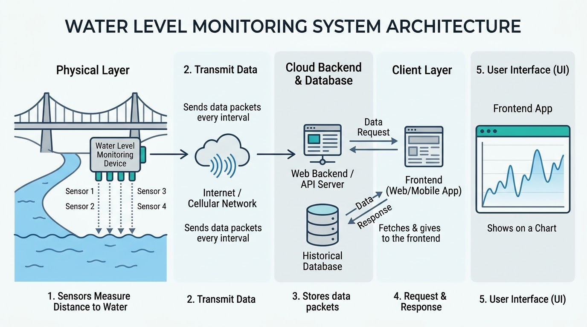

## SURGE - Real-Time Flood Warning System 🌊


An end-to-end IoT and Web solution engineered to bridge remote river level monitoring sensors directly to an interactive, real-time web dashboard.

The system continuously measures water clearance height at river locations using arrayed ultrasonic sensors, transmits telemetry payloads over Wi-Fi, stores historical time-series data, and visualizes real-time threat levels with interactive geographic maps and graphs.

## System Overview



## Usage (Backend)

- Clone the repo:

```bash
git clone https://github.com/WimansaHansanee/SURGE-WebBackend.git
```

- Install dependencies:

```bash
cd SURGE-WebBackend
npm install
```

- Run:

```bash
npm run dev
```

> The frontend is published [here](https://github.com/WimansaHansanee/SURGE-WebFrontend).

## API Endpoints

| **Method** | **Endpoint**       | **Description**                                                      |
| ---------- | ------------------ | -------------------------------------------------------------------- |
| `POST`     | `/api/sensor-data` | Receives JSON payload from Arduino/ESP-01 and inserts into database. |
| `GET`      | `/api/sensor-data` | Returns the most recent reading for live dashboard cards.            |
| `GET`      | `/api/history`     | Returns the last 20 readings for real-time charting.                 |

## Sample Telemetry JSON Payload

```json
{
  "device_id": "SURGE_001",
  "readings": [
    { "sensor_id": 1, "distance_cm": 142.5 },
    { "sensor_id": 2, "distance_cm": 140.0 },
    { "sensor_id": 3, "distance_cm": 145.2 },
    { "sensor_id": 4, "distance_cm": 138.8 }
  ]
}
```

### Testing Without Hardware

If physical hardware is disconnected, you can simulate realistic river level drift by running following `.bat` files.

| Device ID | River                        |
| --------- | ---------------------------- |
| SURGE-001 | Nilwala Ganga                |
| SURGE-002 | Kelani Ganga - Hanwella      |
| SURGE-003 | Kelani Ganga - Kitulgala     |
| SURGE-004 | Kalu Ganga - Ratnapura       |
| SURGE-005 | Gin Ganga                    |
| SURGE-006 | Kalu Ganga - Kalutara        |
| SURGE-007 | Kelani Ganga - Kaduwela      |
| SURGE-008 | Mahaweli Ganga - Peradeniya  |
| SURGE-009 | Mahaweli Ganga - Manampitiya |
| SURGE-010 | Walawe Ganga                 |

All the `.bat` files are here.


## References


- [Web Frontend](https://github.com/WimansaHansanee/SURGE-WebFrontend)

- [Arduino Code and Hardware Wiring]()

- [Simulators](https://github.com/ZentrixMora/SURGE-Simulators)